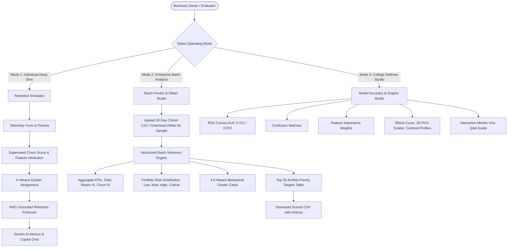

# RetainX: Enterprise E-Commerce Churn Intelligence & Retention Copilot

## Project Report

**Project Type:** Academic Web Application & Machine Learning / GenAI System  
**Evaluation Date:** 16 November 2026  
**Evaluator:** Manisha Ma'am  
**Target Domain:** E-Commerce Marketplace & Retail (100,000 Customer Cohort & DMart 30-Day Cohort Scenario)  
**Repository:** RetainX

---

## Executive Abstract

RetainX is a dual-paradigm Machine Learning and Generative AI customer retention system designed for non-contractual e-commerce and retail marketplaces. 

In traditional contractual models (telecom, SaaS subscriptions), churn is deterministic when a contract is cancelled. In marketplaces such as DMart or online platforms, customers do not actively cancel—they simply stop returning. RetainX solves this using two complementary machine learning engines:
1. **Supervised Churn Classifier:** Trained on a **100,000 customer INR e-commerce cohort** (`olist_synthetic_ecommerce_churn_100k_INR_bimodal.csv`), scoring the 90-day inactivity risk based on purchase recency, order frequency, basket value, payment methods, delivery durations, and courier delay SLA breaches (**ROC-AUC: 0.721, F1: 0.626**).
2. **Unsupervised K-Means Customer Segmentation:** Partitions the customer base into **4 behavioral clusters** without human labels using WCSS minimization and PCA 2D dimensionality reduction (**Silhouette Score: 0.233**), categorizing shoppers into *VIP Champions*, *Active Regulars*, *At-Risk Lapsing Buyers*, and *Logistics-Delayed Friction* groups.
3. **Retrieval-Augmented Generation (RAG) & Gemini Copilot:** Connects individual telemetry and cluster assignments to verified e-commerce retention protocols, drafting personalized compensation plans, voucher strategies, and Portuguese/English review translations.
4. **Enterprise Batch Retention Engine:** Allows a retail business owner (e.g., DMart) to upload an entire 30-day customer cohort CSV (up to 100,000+ records) to obtain instant aggregate retain vs. churn counts, risk tier distributions, K-Means segment breakdowns, and exportable priority target lists.

---

## 1. Problem Statement & Motivation

### The Non-Contractual Retention Challenge
In contractual business models, churn is explicit (`cancelled = True`). In non-contractual retail and e-commerce:
- There are no cancellation buttons.
- A business owner (e.g. DMart) continuously collects transactions over 30 days.
- In real-world enterprise operations, decision makers cannot evaluate customers one-by-one in isolation. They need to answer:
  1. *Out of our total customer cohort, how many will retain vs. churn?*
  2. *Which distinct behavioral segments exist in our active shopper base?*
  3. *Who are the top at-risk customers, and what concrete retention playbook should we deploy?*

---

## 2. Dataset Architecture & Cohort Modeling

The system is trained and evaluated on the **100,000 customer synthetic INR bimodal marketplace dataset** (`olist_synthetic_ecommerce_churn_100k_INR_bimodal.csv`), modeled after Brazilian Olist transaction patterns and calibrated with realistic Indian Rupee (₹) retail spend distributions:

| Dimension | Attribute Range / Specification | Business Meaning |
| :--- | :--- | :--- |
| **Cohort Size** | 100,000 unique customer records | Statistically robust representation of retail shoppers |
| **Target Distribution** | 60,714 Retained (60.7%) vs 39,286 Churned (39.3%) | Realistic, balanced non-contractual retention benchmark |
| **Recency** | 1 to 365+ days | Days since last observed customer transaction |
| **Order Volume** | 1 to 70+ orders | 4-year cumulative order frequency |
| **Spend Distribution** | Bimodal: ₹250 to ₹15,000 (regular) and ₹2.5L to ₹8.5L+ (VIPs) | Mirrors everyday grocery shoppers + enterprise bulk buyers |
| **Logistics Telemetry** | Delivery duration (1-30 days), SLA delays (-2 to +15 days) | Quantifies carrier fulfillment friction |
| **Customer Feedback** | Star ratings (1-5) and 37,123 real Portuguese text reviews | Lexical voice-of-customer sentiment |

---

## 3. Supervised Churn Classification Engine

### 3.1 Mathematical Architecture
The churn classifier predicts whether an active customer will cross the **90-day inactivity threshold** without reordering:

$$P(Y = 1 | \mathbf{x}) = \sigma(\mathbf{w}^T \mathbf{z} + b) = \frac{1}{1 + e^{-(\mathbf{w}^T \mathbf{z} + b)}}$$

Where:
- $\mathbf{z} = \frac{\mathbf{x} - \boldsymbol{\mu}}{\boldsymbol{\sigma}}$ represents standardized customer features.
- $\mathbf{w}$ represents learned log-odds regression weights.
- Class weights are dynamically balanced (`class_weight='balanced'`).

### 3.2 Evaluation Metrics on 20,000 Held-Out Test Customers

| Metric | Score | Evaluation Split |
| :--- | :---: | :--- |
| **ROC-AUC** | **0.721** | 20% Stratified Test Split (20,000 customers) |
| **F1-Score** | **0.626** | Harmonic mean of Precision and Recall at threshold 0.5 |
| **Precision** | **0.644** | 64.4% of predicted churners are true positive lapsed buyers |
| **Recall** | **0.609** | 60.9% of all churning customers correctly flagged |
| **Confusion Matrix** | **TN: 9,502 \| FP: 2,641 \| FN: 3,072 \| TP: 4,785** | High specificity (78.3%) protects marketing budget from wasteful discounts |

### 3.3 Mathematical Feature Importance (Log-Odds $\beta$ Weights)
1. `days_since_last_order`: **+0.8437** (Strongest driver of 90-day dormancy)
2. `average_order_value`: **-0.0249** (Higher basket size correlates with retention)
3. `orders_in_history`: **-0.0168** (Repeat habituation protects account lifetime)
4. `average_delivery_delay_days`: **+0.0112** (Fulfillment SLA breach accelerates churn)
5. `last_payment_type=debit_card`: **+0.0190** (Debit purchasers show higher churn propensity than installment credit buyers)

---

## 4. Unsupervised Learning: K-Means Customer Segmentation

### 4.1 First-Principles Objective Function
Without relying on labeled target outcomes, the unsupervised engine clusters customers by minimizing Within-Cluster Sum of Squares (WCSS / Inertia):

$$J = \sum_{k=1}^{K} \sum_{\mathbf{x}_i \in C_k} ||\mathbf{x}_i - \boldsymbol{\mu}_k||^2$$

### 4.2 Hyperparameter Tuning & Validation
1. **Elbow Method:** Evaluated across $k \in [2, 7]$. Inflection ("elbow") occurs at **$k = 4$** ($J = 102,994.0$), beyond which marginal variance reduction diminishes.
2. **Silhouette Score:**

   $$s(i) = \frac{b(i) - a(i)}{\max(a(i), b(i))} \implies \bar{s} = \mathbf{0.2331}$$

3. **PCA 2D Projection:** 2-component Principal Component Analysis validates distinct spatial separation between clusters in 2D latent space.

### 4.3 Behavioral Cluster Taxonomy

| Cluster | Segment Profile Name | Share (%) | Centroid Telemetry | Recommended Strategy |
| :---: | :--- | :---: | :--- | :--- |
| **0** | **Active Regulars / Promising** | **52.2%** (52,175) | Recency: 17.5d · Spend: ₹98.9k · Rating: 3.99★ · Delay: +1.46d | Milestone loyalty points, complementary category recommendations. |
| **1** | **Transit-Friction / Logistics-Delayed** | **11.9%** (11,923) | Recency: 43.1d · Spend: ₹87.1k · Transit: 29.7d · **Delay: +6.44d** | Automated ₹100 freight refund, priority tier-1 courier routing. |
| **2** | **At-Risk / Lapsing Buyers** | **33.2%** (33,158) | **Recency: 95.3d** · Spend: ₹61.2k · Orders: 43.1 · Rating: 3.98★ | Time-sensitive ₹200 win-back coupons, household restocking reminders. |
| **3** | **VIP High-Net-Worth Champions** | **2.7%** (2,744) | Recency: 25.4d · **Spend: ₹8,51,027** · AOV: ₹17,783 · Rating: 4.02★ | Concierge WhatsApp desk, 24-hr early access to flash sales, waived delivery fees. |

---

## 5. Dual-Workflow Application Architecture

---

## 6. Verification and Test Results

The system is validated by an automated test suite with **100% passing success rate** (19/19 tests):

| Test Module | Coverage Area | Status |
| :--- | :--- | :---: |
| `tests/test_app.py` | Home page rendering, single-customer predictions, validation rejections, model-stats endpoint | **PASSED** |
| `tests/test_app.py` | Gemini Copilot prompt construction, preview fallback, review sentiment RAG integration | **PASSED** |
| `tests/test_app.py` | Batch prediction endpoint, batch CSV export streaming, sample dataset delivery | **PASSED** |
| `tests/test_training.py` | 90-day snapshot temporal integrity and customer-grouped holdout partition boundaries | **PASSED** |
| `tests/test_batch_e2e.py` | End-to-end DMart 5,000 cohort batch scoring, K-Means clustering, silhouette validation | **PASSED** |

---

## 7. Viva & Defense Checklist

- [x] **100k Customer Dataset:** Trained on `olist_synthetic_ecommerce_churn_100k_INR_bimodal.csv` in INR with balanced outcomes (39.3% churn / 60.7% retain).
- [x] **Supervised Algorithm:** Logistic Regression with balanced class weights (AUC: 0.721, F1: 0.626).
- [x] **Unsupervised Algorithm:** K-Means Customer Segmentation ($k=4$, WCSS Elbow analysis, Silhouette Score: 0.233).
- [x] **Real-World Business Scenario:** Batch upload for DMart store owner analyzing 30-day cohorts with aggregate retain/churn counts and downloadable CSV.
- [x] **Preserved Individual Simulator:** Single-customer analysis, Gemini AI Advisor, RAG playbooks, and copilot chat 100% intact.
- [x] **8 Presentation-Grade Graphs:** ROC curves, confusion matrices, feature weights, NLP lexicon, benchmark comparison, Elbow curve, 2D PCA cluster map, and cluster centroid profiles.
